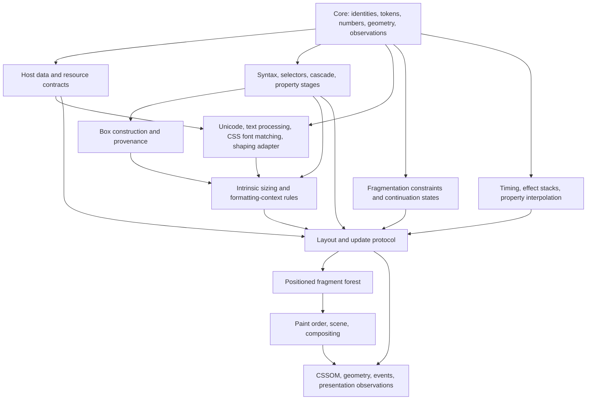

# Whole-CSS semantics architecture: feasibility and concrete interfaces

Research proposal, 19 October 2026. No definitions or theorems below were compiled or proved. The target remains the entirety of a pinned CSS specification universe and its normative dependencies. A pilot is an intermediate result, not a replacement for that target.

## Decision

A comprehensive Lean model is plausible as a sustained specification-engineering program. A practical executable reference is an additional undertaking, and proving that Firefox implements it is substantially larger still. The current library supplies useful style/syntax foundations, but its organization and theorem totals do not establish coverage of layout, typography, painting or dynamic browser behavior.

Keep three deliverables separately auditable:

| Deliverable | Required evidence | Does not establish |
|---|---|---|
| Requirements model | Each pinned normative requirement has an independently reviewed formal meaning, exceptions, observations and cross-module dependencies | That the prose was interpreted correctly merely because Lean accepts it |
| Executable reference | Algorithms refine those relations, terminate on stated domains, preserve errors and permitted choices | Correctness of the compiler, runtime or real engine |
| Engine refinement | Actual source constructors, providers, representations, histories and observations simulate the model | Whole Firefox correctness from a Stylo-only theorem |

## What changes from the previous roadmap

The previous architecture's package separation, phase types and explicit providers are sound starting points. Three refinements are necessary before implementation:

1. **Layout and fragmentation form a protocol.** A universal `style → box → fragment → layout → paint` pipeline puts fragments too early. Boxes acquire fragments during layout, including line wrapping, page/column breaking and bidi splitting. Use `style → box construction → layout/fragmentation protocol → positioned fragments → painting`; sizing and text supply queries during that protocol. This follows the actual box/fragment distinction in [Display 3](https://drafts.csswg.org/css-display-3/#intro).
2. **An environment service must not become an oracle for unmodeled CSS.** Raw fonts, available devices and resource deliveries can be external inputs. Font matching, percentage-basis selection and stylesheet activation are CSS responsibilities. Keep an explicit ledger of which internal producer must discharge each consumer's request.
3. **History theorems need an observation relation, not old-state identity.** Recomputing a fresh style may change unrelated flags, layout object identities and cache contents. The recent substituted-inherit component illustrates the issue: local OR preserves incoming flag bits, but reusing a model's old `otherFlags` through a whole recascade is an additional frame assumption. Prove selected observations plus dependency publication; quotient only demonstrably unobservable implementation state.

### Actual library fit

The inspected repository has one `lean_lib CssSemantics`, no additional Lake dependencies, and 1,983 direct Lean modules totaling 10,157,868 bytes. `coverage.json` records 127 feature profiles and explicitly sets full CSS conformance, mechanized prose translation and browser refinement to false. Its layout-rendering profile is unsupported. These are inventory facts, not freshly replayed proof claims.

`Dom.ElementForest` already separates abstract nodes and a decreasing parent-depth law; `Executable` connects finite matching decisions to relations. `Style` uses generic selector/cascade contracts. `TransitionMachine.run_iff` and `Runs.preserves` are reusable state-machine patterns, not CSS animation semantics. `CssFiniteScalar` and supplied numeric environments establish useful conditional fragments; actual fonts, viewport acquisition and layout percentage bases remain outside them. The retained representative source files and hashes are in LOCAL.json.

## Dependency graph

This is an **import/contract DAG**. Runtime feedback lives in the protocol node, not in circular module imports.



Animation contributes values at the appropriate cascade origin; it is not merely a transformation of finished pixels. The effect stack consumes an underlying value and passes each result to the next effect. [Web Animations effect composition](https://drafts.csswg.org/web-animations-1/#calculating-the-result-of-an-effect-stack)

The neutral semantic library owns these contracts. Executable algorithms and Gecko adapters are separate clients. Stylesheet discovery, shadow/flat trees, pseudo ownership and effective inheritance must connect to actual constructors before stronger claims can replace supplied-input hypotheses.

## Interface sketch 1: property stages and dependency requests

The following is Lean-like pseudocode. Names such as `Computes` require separately written normative relations; they are not defined by equality to the executable function.

```lean
structure PropertySemantics (Registry : Type) where
  Property  : Registry → Type
  Specified : (r : Registry) → Property r → Type
  Computed  : (r : Registry) → Property r → Type
  Used      : (r : Registry) → Property r → Type

inductive EnvQuery : Type → Type
  | viewport : ViewportId → EnvQuery ViewportFacts
  | fontData : ResourceId → EnvQuery RawFontData
  | imageData : ResourceId → EnvQuery DecodedImageFacts

inductive CssQuery : Type → Type
  | parentComputed : SubjectId → PropertyId → CssQuery ComputedPayload
  | intrinsic : BoxId → Axis → SizingPhase → CssQuery SizeContribution
  | containerGeometry : ContainerId → QueryPhase → CssQuery GeometryFacts

structure ComputationResult (A : Type) where
  outcome : CssOutcome A             -- value / specified CSS invalidity
  reads : FiniteSet DependencyKey
  effects : List SemanticEffect

-- Pending request, model Unsupported and resource exhaustion are separate
-- execution statuses, not silently converted to CSS invalidity.
```

Registry identity includes registration version; the same custom-property name can acquire a different grammar. Parent subject, property, axis, phase and resource identity are carried in keys. The same environment snapshot must connect all component theorems. Logical-to-physical mapping and shorthand expansion belong to explicit phases, not one permanent global ID conversion.

Two essential contracts:

- **Value/effect correctness:** a successful execution under admitted replies satisfies the independent computation relation, including invalidity and observer effects. A footprint must include decisions affecting failure/fallback as well as successful output; a value-only equivalence can miss cache or attribute observation.
- **Dependency sufficiency:** if two admitted snapshots agree on the recorded reads, re-execution preserves the specified observation. For nondeterministic branches, quantify over the same admitted policy. A footprint containing every input is sound but may be useless for performance; minimality is a separate optimization theorem.

The consumer may initially assume a `CssQuery` reply relation, but whole-CSS closure requires a real model producer proving it. `EnvQuery` inputs remain explicit world facts. Requesting `the correct final layout` would be circular and is forbidden. [Cascade value processing](https://drafts.csswg.org/css-cascade-5/#value-stages) distinguishes computed, used and actual stages; the CSSOM resolved-value projection is property-specific, so it cannot be an alias for this Computed type.

## Interface sketch 2: boxes, layout and fragment continuations

```lean
structure Fragment where
  owner : BoxId
  source : ContentProvenance
  logicalGeometry : FragmentGeometry
  decorationRole : DecorationRole

structure LayoutCursor where
  remaining : ContentCursor
  activeContexts : List FormattingContextState
  breakState : BreakState
  fragmentainer : FragmentainerState

-- Relation defined from formatting/fragmentation clauses, not from layoutStep.
def LayoutStep (world : Snapshot) (policy : LayoutPolicy)
    (boxes : BoxForest) (before : LayoutCursor)
    (emitted : List Fragment) (after : LayoutCursor) : Prop := ...

def layoutStep (...) : ExecutionResult (List Fragment × LayoutCursor) := ...

theorem step_sound : layoutStep ... = .completed (fs, next) →
  LayoutStep world policy boxes old fs next := ...

theorem finished_layout_sound :
  AdmittedBoxForest world boxes → RunsLayout world policy boxes trace →
  Completed trace → SpecPositionedFragments world boxes (emitted trace) := ...
```

A continuation must retain the information needed for adjoining margins, decorations, forced breaks, floats and formatting context rules. It cannot be just a box index. Conversely, an opaque token containing an already-computed reference answer would make correspondence vacuous. Define each stored field's meaning and producer invariant.

Content conservation relates source spans to emitted content, excluding content suppressed during box construction. It must distinguish repeated decorations from duplicated content and logical text provenance from visual bidi order. A box has zero/one/many relationships to subjects and fragments; a universal `Node → Rect` loses these distinctions. Position, border box, overflow region, scroll geometry and painted bounds need different observations.

**Sizing is phase-sensitive.** Intrinsic contributions and final used sizes cannot share a generic “resolve percentage” operation without an explicit phase. Cyclic percentage rules prescribe treatments by contribution and element category. A generic least-fixed-point solution is not automatically CSS's algorithm. [Sizing cyclic percentages](https://drafts.csswg.org/css-sizing-3/#cyclic-percentage-contribution)

**Termination is a theorem to earn.** Remaining content alone need not decrease at every layout step: a step can start a fragmentainer, place a float or process a forced break. Each supported algorithm needs a well-founded measure or a documented operational partiality condition. Arbitrary fuel exhaustion cannot be labeled a valid CSS result. Fragmentation permits choices among allowed breaks but constrains legality; a policy must discharge those constraints. [Fragmentation rules](https://drafts.csswg.org/css-break-3/#breaking-rules), [unforced-break optimization](https://drafts.csswg.org/css-break-3/#best-breaks)

## Interface sketch 3: resources, time, CSSOM and incremental equivalence

```lean
inductive InputEvent
  | domEdit (edit : DOMEdit)
  | cssomEdit (edit : CSSOMEdit)
  | resourceDelivery (resource : ResourceId) (reply : ResourceReply)
  | environmentChange (delta : EnvironmentDelta)
  | clockSample (sample : ClockSample)
  | observe (request : ObservationRequest)

-- Internal update transitions may be silent; public observations may not be lost.
def SpecStep : SemanticState → InputEvent → List Observation → SemanticState → Prop := ...
def EngineStep : EngineState → InputEvent → List Observation → EngineState → Prop := ...
def Related : SemanticState → EngineState → Prop := ...

theorem observation_simulation :
  Related spec engine → EngineStep engine event observations engine' →
  ∃ spec', SpecSteps spec event observations spec' ∧ Related spec' engine' := ...
```

This shape permits internal stuttering and changing allocation/cache identities. It does not permit dropping observable events or declaring a stale CSSOM result “not ready”. The observation operation's own semantics must perform or require the specified updates. Safety at ready checkpoints, scheduling/progress and eventual delivery under justified fairness are different obligations.

A useful intermediate theorem is `incremental observation = fresh recomputation observation` for the same event history, world versions and policy. It is conditional until delivery and cache invalidation are modeled. Both sides must use the same font/resource/time state; independent existential choices would mask stale data. CSSOM observations include indexed declarations and resolved values, not just final paint. [CSSOM getComputedStyle](https://drafts.csswg.org/cssom/#dom-window-getcomputedstyle)

## Honest external contracts versus hidden missing CSS

| Boundary | Honest external input/assumption | What must stay inside the CSS responsibility ledger |
|---|---|---|
| Fonts | Available font inventory, actual file bytes and variation data; initially a clearly admitted shaping service | CSS family/face matching, synthesis rules, font-feature selection, fallback interaction, loading policy and metric-dependent recomputation |
| Text | Pinned Unicode data and language/dictionary data, with declared implementation choices | Whitespace/text transforms, bidi integration, break prohibitions, spacing, shaping boundaries, line construction and source mapping |
| Images | Resource bytes and decoded intrinsic facts under a decoder contract | Replaced-element sizing, object fitting, CSS image selection and resource-dependent invalidation |
| Viewports/containers | Physical viewport/device observations | Container selection, axis/writing-mode mapping, containment, query evaluation and required update protocol |
| Time/network | Delivered timestamps and resource outcomes | CSS animation timing/effect/cascade rules, font-display behavior, stylesheet activation, relevant API/event semantics |
| Painting | Device profile and admitted rasterizer limits | Stacking/paint order, transforms, clip/filter grouping, blending/compositing and CSS color processing |

Fonts explicitly leaves the installed-font set undefined, while specifying a matching algorithm. Supplying the set is therefore reasonable; supplying an arbitrary final matched font is not whole-module coverage. [Fonts matching](https://drafts.csswg.org/css-fonts-4/#font-matching-algorithm)

Text providers need context-sensitive cluster/source correspondence, not just a nonnegative width. Negative advances/offsets or reordered glyphs must not be excluded without a rule-specific proof. Font-format and Unicode algorithms can be separate verification projects, but until connected they remain assumptions on the CSS theorem. [Text 3](https://drafts.csswg.org/css-text-3/#intro)

Painting should first produce a semantic scene with ordered groups and clipping/compositing operations. Pixel observations require additional numerical and rasterization correspondence. Declaring a free pixel oracle would hide almost the whole rendering requirement. Screen, paged and speech presentation are distinct targets; a screen pilot cannot define the final universe.

## Nondeterminism, numerics and executability

Distinguish three sources of variability: explicit UA discretion; actual external data; and model gaps. Only the first is a normative choice. For example, unforced fragmentation can select among allowed breaks; unknown spec interpretation must not become permission to return anything.

Use a stable policy object with per-clause constraints and history coherence. For a deterministic profile, prove executable iff declarative semantics. For a permitted-choice profile, prove executable soundness for each admitted policy; separately assess completeness over policies. Do not demand a practical enumerator for arbitrary real outcomes. Symbolic expressions or certified enclosures can support a reference, with unresolved decisions reported honestly.

Use connected numerical domains: exact integer/rational syntax and units; signed zero and specified exceptional arithmetic; symbolic/real analytic values where required; then finite implementation policies. Range, rounding, clamping and precision are context-specific. CSS Values permits implementation-defined precision/range but still constrains conversion of unsupported values; this is not blanket permission for every numerical discrepancy. [Values numeric types](https://drafts.csswg.org/css-values-4/#numeric-types)

A global epsilon cannot justify branch changes at zero, equality, range boundaries, breakpoints or clipping. Every abstraction needs a relation preserving required decisions or explicitly permitted alternatives. The current finite-rational fragment should embed with proofs; it should not be silently replaced with Float. A larger analysis library may be justified for real-valued transforms, easing and color, but should be pinned and isolated so token/selector clients retain small imports.

## Highest-value implementation pilot

**Build a closed style-to-box contract with one dynamic dependency, before a broad layout implementation.**

1. Adapt existing visibility/defaulting and numeric-environment results to a three-property registry: visibility, display, and one explicitly scoped definite/percentage sizing case. Specify actual input grammar and phase admission; do not admit already-correct computed outputs as the entire frontend.
2. Implement finite ordinary box construction including display:none, display:contents and one anonymous-box rule. Preserve subject/text provenance and distinguish element inheritance from anonymous-box inheritance.
3. Implement one unfragmented normal-flow sizing/placement case against an independent relation, with concrete viewport/containing-block basis construction. Text shaping may be excluded from this pilot explicitly; its future interface must still exist.
4. Add a parent or viewport mutation and one CSSOM/geometry observation. Prove dependency publication and incremental/fresh agreement through the actual model update protocol, not a magic refresh assumption.

Exit requires one vertical theorem from admitted raw input to the selected observation, nonvacuous executions, a specified invalid/unsupported boundary, and semantic counterexamples for missing box provenance and missing invalidation. Two clients must use the property/request interface. This pilot tests whether the architecture composes; a pile of standalone geometry identities does not.

Follow with text/inline layout plus controlled fonts; separate flex/grid/table algorithms using shared sizing; paged/column fragmentation; paint/compositing; timing and dynamic integration throughout. Do not defer lifecycle correctness to the end.

## Integration and hard obstacles

Keep the existing library intact. Add small public namespaces for Core, PropertyStages, BoxConstruction, LayoutProtocol, Observations and HostContracts; embed old results via explicit correspondence theorems. Reference code and native adapters should import these facades, not an ever-growing collection of concrete profile files. Refactor only when two real clients expose the needed shared theorem.

Parallel units can own property stages, box/sizing, text/fonts, and host/observation contracts, with one interface integration owner and separate proof/spec review. Their outputs must discharge each other's premises using identical IDs, versions and policies. Shared definition changes trigger downstream compilation and claim review. No number of agents removes the integration obligation.

Hard obstacles remain: incompatible draft interpretations; overlapping layout/sizing algorithms; text and multilingual shaping; numerical branch fidelity; host/caching/resource histories; CSSOM ordering/serialization; memory/FFI/concurrency and compiler correctness for native refinement. Frozen source hashes and finite browser agreement detect drift and concrete bugs but do not close those proofs.

Lean's kernel checks elaborated terms against its type theory and axioms. It cannot establish that the formal relation matches CSS prose, that an input predicate admits all normative cases, that a source extractor is correct, or that a compiled browser implements the relation. Native evaluation adds a broader compiler trust dependency; audit theorem dependencies explicitly. [Lean elaboration and compilation](https://lean-lang.org/doc/reference/latest/Elaboration-and-Compilation/), [Lean axioms](https://lean-lang.org/doc/reference/latest/Axioms/)

A composition theorem that assumes every requested result already satisfies the complete final spec may be valid but advances no admission. Track each assumption to its actual producer, and separately list axioms, mathematical premises, external-world inputs, missing model families, and native correspondence gaps. That accounting is the difference between a scalable whole-CSS program and an indefinitely growing collection of conditional fragments.

## Evidence and limits of this research

LOCAL.json binds the prior architecture and representative current library files; INVENTORY.json records organization counts. Eleven freshly retrieved primary HTML documents are retained with HTTP status, URL, timestamp and hashes in spec/FETCH.json. These are source evidence, not mechanized specification translations. Pseudocode is deliberately uncompiled. No browser, native build, Git operation or production edit occurred. No generated build targets were created. The evidence checker verifies identity and roster only, not the research conclusions.
