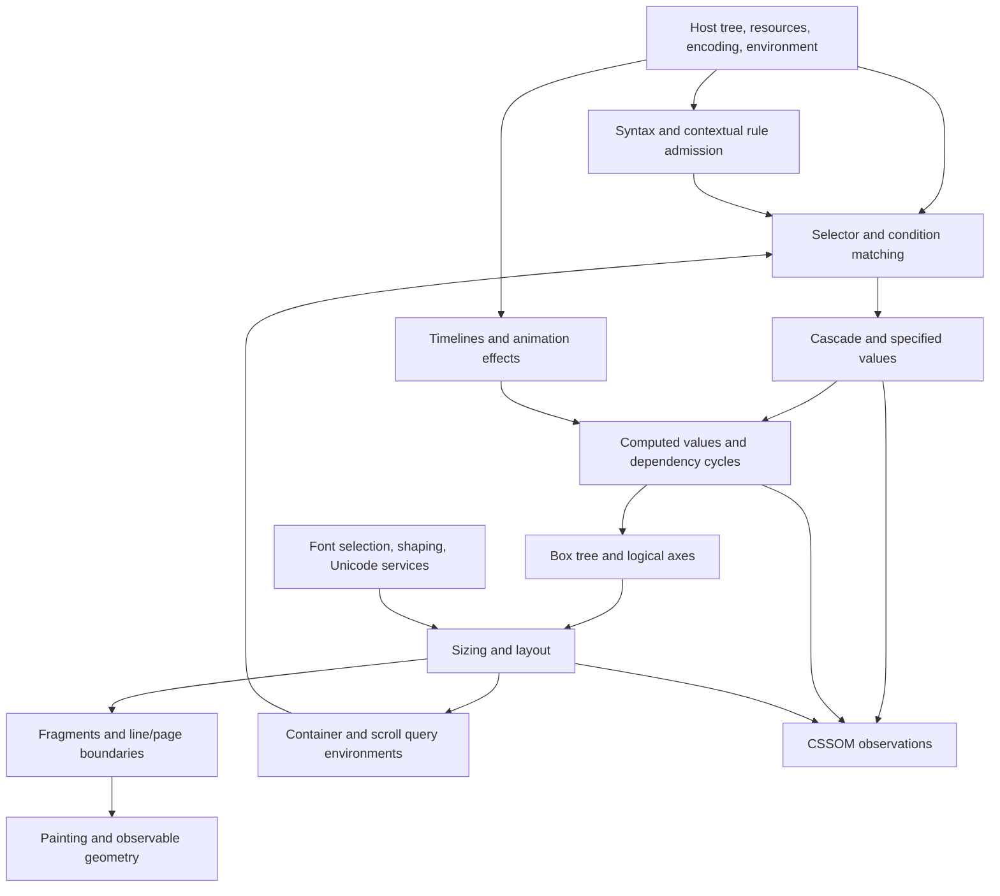

# Research track 1: what a complete CSS model would have to cover

Research date: 19 October 2026. This is a scope/dependency proposal, not a new verification result. Local inputs are captured in `inventory-local-receipt.json`; primary web retrievals are retained in `inventory-web-*.txt`.

## Recommendation

Define a **versioned CSS semantics project**, with a finite requirements inventory and separately named conformance profiles. Keep a second ledger for refinement of Firefox. “All CSS in Lean” can be a defensible long-term research objective if every normative obligation has an explicit disposition; it is not a single translation pass or a meaningful percentage of the current theorem count.

The latest published stable-scope reference checked here is **CSS Snapshot 2026, W3C Group Note of 22 June 2026**. It distinguishes the official definition, reliable candidates, fairly stable modules and rough interoperability. These tiers describe specification maturity, not what desktop Firefox implements. Use the dated publication as one root and pin selected editor drafts independently. [Dated Snapshot 2026](https://www.w3.org/TR/2026/NOTE-css-2026-20260622/), [CSS current work](https://www.w3.org/Style/CSS/current-work).

## 1. Three explicit inventories

| Inventory | Membership and purpose | Completion claim it can support |
| --- | --- | --- |
| Stable CSS profile | Snapshot official-definition modules, their applicable normative dependencies, errata and replacement relations | A fixed stable CSS semantics target; not every contemporary browser feature |
| Current browser/draft profile | Explicit additional modules/levels and feature revisions chosen from current CSSWG work, plus CSS-adjacent FXTF/Houdini APIs | A dated modern-browser feature target; unstable text and unresolved issues stay visible |
| Historical/optional ledger | Superseded clauses, legacy compatibility, abandoned drafts, print/speech or optional capabilities not selected in the browser profile | An accounting of exclusions and compatibility, not silent deletion from “all CSS” |

A union of all published CSS levels is inconsistent: newer modules replace particular older clauses, while delta specifications depend on earlier complete definitions. Preserve a **clause-level supersession graph**, including remaining CSS2 behavior. Do not select only the highest numeric level or discard CSS2 wholesale. The snapshot itself describes specific replacement boundaries. [Snapshot classification](https://www.w3.org/TR/css-2026/#css), [CSS2](https://drafts.csswg.org/css2/).

“All CSS” without a desktop qualifier also has to account for paged presentation and speech. A first browser profile may defer them, but its claim must name that exclusion. Optional and UA-dependent behavior needs guarded obligations and constrained choices, not an invented deterministic answer. An ambiguous requirement should have an interpretation issue and possibly competing models; proving one interpretation does not resolve the standards issue. [CSS Speech](https://drafts.csswg.org/css-speech-1/), [CSS Fragmentation](https://drafts.csswg.org/css-break-3/).

## 2. What the existing standalone library actually supplies

The captured `coverage.json` explicitly sets `full_css_conformance`, `mechanized_prose_translation` and `browser_refinement` to false. It has 127 historical feature records: 120 `checked_fragment` and seven `unsupported`. These are overlapping, differently scoped profiles; **120/127 is not CSS coverage**. Some older unsupported records coexist with later partial source support. The current semantic checkpoint is `ordinary-import-source-scope-v1`.

The useful foundation is substantial: scalar tokenization and component syntax, independent rule/declaration relations, DOM/selector fragments, specificity, cascade/defaulting, variables, mathematical value/type fragments, and bounded source-to-visibility composition with layers, imports and scopes. The coverage map carefully limits host acquisition, recovery, registered properties, general value grammars, source history and dynamic environments. The opaque environment/provider assumptions are exactly where future family composition must attach.

The library's own coverage map states that layout, intrinsic sizing, flex/grid/tables, fragmentation, shaping/fonts, painting/compositing, colors, transforms and timing lack broad semantic implementations. Native source-bound repair companions elsewhere in the workspace are valuable separate evidence; their existence does not automatically fill these standalone semantic rows. Import requires reviewed shared definitions and an exact correspondence theorem, with counterexamples and assumptions preserved.

## 3. Major-family gap and dependency map

This is a research partition, not an exhaustive property list. Every row must expand into requirement records before any completeness claim.

| Family | Existing standalone foothold | Essential missing semantics/dependencies | First useful complete slice |
| --- | --- | --- | --- |
| Input, tokens, rules, property grammar | Broad scalar tokenizer/component and recursive rule fragments | Byte decoding, full contextual recovery, property/value grammar registry, CSSOM source/serialization distinctions | One complete source→declaration→specified-value contract with errors and exact source identity |
| Selectors, DOM, namespaces, scopes, pseudo-elements | Many ordinary-tree and source-selector fragments | Complete validity/forgiving rules; shadow/featureless trees; dynamic state; pseudo-element subjects; namespace/host acquisition | One host profile with complete selector validity and explicit pseudo/shadow exclusions, then remove exclusions systematically |
| Cascade, inheritance, custom properties | Precedence/defaulting and bounded layer/import/scope pipelines | All origins/encapsulation, shorthands/aliases, registrations, taint/cycles, animation contributions, rollback and dynamic sheet lifecycle | Complete declaration/control and custom-property dependency pipeline on one fixed host |
| Values and computed property families | Typed symbolic arithmetic and bounded property finalization | General grammar/type/stage semantics, colors/images/positions/transforms, concrete font/viewport/container environments, numerical tolerances | A typed property registry linking grammar, initial/inherited values, computation, serialization and animation type |
| Conditions and style/layout feedback | Supplied/global condition fragments and name-only container eligibility | Media/supports/style/size/scroll query evaluation, query units, invalidation and cycle-breaking | Fully specified query evaluation on an explicit environment, then actual environment construction |
| Box construction and logical geometry | No broad implementation | Element→box/anonymous-box/pseudo trees, display, writing modes, containing blocks, replaced content | Ordinary block formatting in logical axes with generated box-tree provenance |
| Intrinsic sizing and layout | No broad implementation | Definite/indefinite sizes, percentage cycles, min/max contributions, block/inline/floats/positioning, flex/grid/table algorithms | Sizing+normal block layout with exact geometry and admitted text metrics; expand formatting contexts individually |
| Text and fonts | No broad standalone implementation | White-space processing, segmentation, bidi, shaping, fallback, metrics, hyphenation, line construction and justification; font loading/availability | A fully connected text normalization→break opportunities→line measurement contract with explicit font provider obligations |
| Fragmentation and generated content | No broad implementation | Break opportunities/selection, continuations, columns/pages, counters, lists, ruby and cross-fragment decoration | Fragment a previously modeled flow, preserving content order and boundary state |
| Painting and compositing | No broad implementation | Stacking/order, backgrounds/borders, clipping/masking, images/colors, transforms, filters/blending, device mapping and hit testing | A display-list semantics and ideal compositing model with explicit rasterization tolerances/provider contracts |
| Animation and transitions | No broad implementation | Timelines, effect stacks, interpolation/addition, property types, event/promise timing, scroll/view timelines | One complete timing/effect-stack semantics joined to actual computed property values |
| CSSOM, loading and browser lifecycle | Bounded static host/source observations | Rule objects/mutations, getComputedStyle, resource Fetch/CSP/URL/encoding, adopted/linked sheets, FontFace, worker contexts, restyle/reflow publication | One document lifecycle through mutation and recomputation, not only frozen snapshots |
| User interaction, preferences and other media | No broad implementation | Focus/selection/cursors/appearance, accessibility-related adjustments, privacy restrictions, printing and speech | Explicit environment/profile records with required behavior and permitted UA choice |

The family boundaries above follow the distinct objects and algorithms in current [Display](https://drafts.csswg.org/css-display-3/), [Sizing](https://drafts.csswg.org/css-sizing-3/), [Flexbox](https://drafts.csswg.org/css-flexbox-1/), [Grid](https://drafts.csswg.org/css-grid-2/), [Text](https://drafts.csswg.org/css-text-3/), [Fonts](https://drafts.csswg.org/css-fonts-4/), [Pseudo-elements](https://drafts.csswg.org/css-pseudo-4/), [Web Animations](https://drafts.csswg.org/web-animations-1/), [Font Loading](https://drafts.csswg.org/css-font-loading/), [CSSOM](https://drafts.csswg.org/cssom/) and [UI](https://drafts.csswg.org/css-ui-4/) specifications. The proposed slices and prioritization are research judgment, not requirements stated by those documents.

### Dependency structure

This is not a simple acyclic pipeline. Container/style dependencies, custom-property cycles, font metrics and intrinsic percentages require the specification's ordering, invalidation and cycle-breaking rules. A generic fixed-point assumption is not a substitute. Model updates and observable publication as histories where the spec requires them. [Conditional Rules 5](https://drafts.csswg.org/css-conditional-5/), [Sizing percentage contributions](https://drafts.csswg.org/css-sizing-3/#intrinsic-contribution).

External semantic dependencies are selective, not “prove every referenced standard in full.” Inventory the invoked contracts: DOM/HTML tree and lifecycle; URL/Fetch/CSP/Encoding; Unicode segmentation/bidi/case data and tailoring; OpenType/font formats and font services; SVG/replaced-image behavior; WebIDL/API timing. Pin data versions as well as algorithm versions. CSS Text requires extended grapheme-cluster foundations and imposes specific line-breaking rules while retaining language-sensitive latitude; treating all of Unicode line breaking as one unconstrained oracle loses meaningful obligations. [Text characters](https://drafts.csswg.org/css-text-3/#characters), [Text line breaking](https://drafts.csswg.org/css-text-3/#line-breaking), [Fonts matching](https://drafts.csswg.org/css-fonts-4/#font-matching-algorithm).

## 4. Requirement-level accounting

Use separate axes, not one progress badge. Each record should contain:

- **Identity:** spec revision/content hash, clause/algorithm anchor, stable local requirement ID and exact source span; supersedes/extends edges.
- **Applicability:** selected profile, feature flags, media/host conditions, normative versus informative status, optional or UA-defined choices and constraints.
- **Semantics:** independent relation/model definitions, input/output/error/temporal observations, nondeterminism, numerical tolerances, and interpretation review.
- **Obligations:** dependency requirement IDs; provider contracts; source admission; totality/progress; invariant/refinement statement; declared trusted assumptions.
- **Evidence:** Lean declarations and axiom audit, extraction/source bindings, model and native semantic mutants, WPT/finite diagnostics, exact independent replay.
- **Disposition:** untriaged / modeled / proved-under-listed-premises / premises-discharged / native-refined / counterexample / ambiguous / excluded-by-profile / superseded. Keep browser evidence separately keyed.

A property usually creates several requirements: parse grammar, declaration validity, cascade participation, computed and used stages, inheritance, serialization, interpolation, dynamic invalidation and cross-module effects. An algorithm step may have multiple branches. A normative rule may have no “must” keyword. Neither property counts nor extracted definitions provide the requirement denominator.

For example, “CSSOM enumerates effective custom properties” separates effective-map shadowing, unique names, excluded invalid values, host applicability, length/index consistency and unspecified ordering. A token/iterator theorem alone must not mark all of those complete. Likewise, “grid supported” requires construction/placement, track sizing, intrinsic contributions, alignment, fragmentation and dynamic updates; one sizing theorem does not close the family.

Report **named unmet obligations and dependency cut sets**. A profile is semantically complete only after every applicable requirement has a reviewed formal interpretation and proof coverage, with every remaining external premise explicitly part of the claim. An implementation-refinement claim additionally requires source/caller/provider and observation bridges. Do not hide false premises by shrinking a formerly admitted input domain; version and explain any genuine scope change.

## 5. How to build and maintain the inventory

1. Pin the snapshot, selected drafts, source repository revisions and retrieved rendered bytes. Maintain the exact dependency/replacement graph. The snapshot's Bikeshed source exposes shortname/status/group/ED/TR metadata; rendered definitions and links supply further structure. [Snapshot source](https://github.com/w3c/csswg-drafts/blob/main/css-2026/Overview.bs), [Bikeshed metadata and definitions](https://speced.github.io/bikeshed/).
2. Seed module and term discovery from browser-specs and Webref, then reconcile it manually with the complete CSSWG landscape. browser-specs distinguishes series/current full specifications and delta composition, but deliberately omits fully superseded and some early drafts. It cannot alone define “all CSS.” [browser-specs](https://github.com/w3c/browser-specs).
3. Use Webref's CSS/IDL/definition/link/reference extracts to enumerate properties, scoped types, APIs and normative dependency candidates. Version 7 CSS extracts are consolidated. These are structured discovery inputs, not a translation of normative algorithms. Keep their release/crawl identity and curation provenance. [Webref](https://github.com/w3c/webref).
4. Human-review the normative prose and algorithm branches into requirement records. Attach all implicit shared conventions and cross-module constraints; mark editorial examples/notes separately. Preserve a prose→model review boundary even when AI drafts the model.
5. Map the existing 127 feature records to requirements and profiles without deleting historical limitations. A theorem can support several obligations, and an obligation can need several theorems; retain this many-to-many structure.
6. On spec updates, classify editorial versus semantic changes, compute affected dependency closure and re-review those records. Keep old version profiles reproducible. A clean Lean build alone does not establish that changed prose is still modeled.

Bikeshed/Webref can automate navigation, identifiers, grammar extraction and change detection. They cannot reliably infer all prose meaning, UA latitude, algorithm coupling or trusted-boundary completeness. No full mechanical CSS-spec-to-Lean translation exists in these inspected inputs.

## 6. Concrete milestones and critical path

| Milestone | Deliverable / exit condition |
| --- | --- |
| A. Versioned denominator | Choose stable and current-browser profiles; enumerate modules, replacement edges and applicable normative requirements; every exclusion and ambiguity named. No coverage percentage before this exists. |
| B. Shared semantic interfaces | Agree on source/code-unit identities, DOM/flat-tree/pseudo subjects, value stages, dimensions, environments, resource identities, geometry and time; unify existing fragments only where their contracts actually compose. |
| C. Complete style slice | Finish the current source/selector/cascade/custom/value pipeline for an explicit property/host profile, including errors and dynamic updates. Discharge its caller/provider assumptions instead of merely increasing fixture counts. |
| D. First layout semantics | Add box construction, writing modes, sizing and ordinary block/inline layout; connect a specified text/font provider and explicit geometry observations. This creates reusable interfaces for flex/grid/table work. |
| E. Independent family expansion | Implement flex/grid/table/fragmentation, fonts/text, rendering and animations against the shared interfaces, with per-family normative ledgers and cross-family composition obligations. |
| F. Host and observable closure | Join loading, CSSOM mutations, animation/resource changes and incremental recomputation to the static semantics. Establish permitted observations, including privacy and UA latitude. |
| G. Per-version completeness review | Independent audit that all in-profile requirements and dependencies have dispositions; preserve unresolved interpretations and counterexamples. Separately report native refinement and trusted services. |

The critical path is shared semantic interfaces and meaningful provider/caller composition, then text/sizing/box-tree dependencies for layout. Pure family work can proceed in parallel once interfaces exist. A bounded rendering model can start with abstract display lists; claiming pixel-level equivalence additionally requires fonts, color/device behavior, rasterization and tolerances. Completing draft grammar lists first does not unblock those dependencies.

There is no defensible calendar estimate or percentage from the present artifacts. A better planning signal is the number and nature of unresolved interfaces, spec ambiguities and high-dependency requirements, reviewed after each complete slice.

## 7. Separate claim: verification of Stylo/Firefox

A standalone Lean semantics should remain usable without Firefox and should follow selected spec revisions. Firefox refinements bind actual representation, control flow, caching, invalidation, providers and published observations to that semantics. Keep those adapters and compiler/memory/numeric assumptions separately versioned.

Stylo covers major style-system duties but does not alone implement every CSS observable: layout, text/font services, animation integration, CSSOM/DOM loading and painting involve other Gecko components. Thus even an exhaustive Stylo refinement would not establish all-CSS browser conformance. Conversely, a comprehensive specification model would not prove Stylo correct without that implementation relation. This architectural distinction is essential to the roadmap, not a reason to defer useful narrow bug-finding proofs.

## Evidence limits

This track read the standalone coverage records and surveyed the primary sources linked above. It did not enumerate every current normative clause, execute Lean, inspect every Gecko subsystem, or prove the proposed dependency graph complete. The inventory bootstrap and milestone plan are the deliverables. The source captures retain retrieval/crawl metadata; mutable editor-draft URLs must be pinned before proof work. Existing accepted artifacts remain unchanged.
