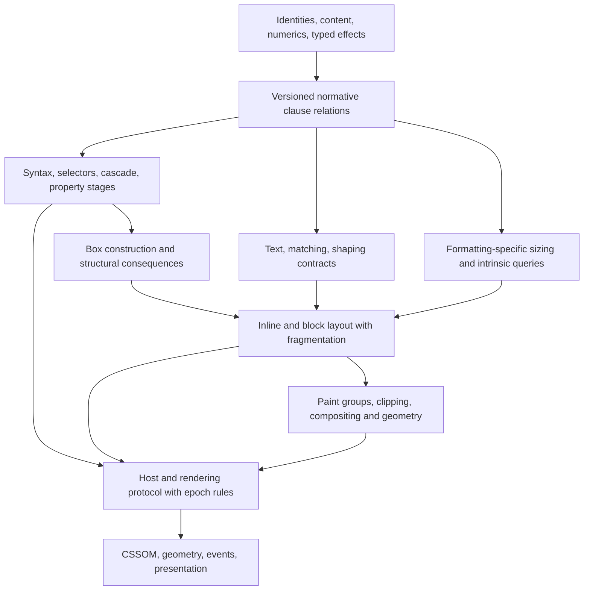

# Whole-CSS semantics: testing the composition architecture

Research proposal, 19 October 2026. **No new definitions or theorems in this report have been compiled.** This report tests and strengthens the earlier roadmap and v2 architecture; it does not replace their whole-CSS objective with the pilot below.

## What it would take

Covering **all selected CSS** requires a versioned requirements model, connected algorithms, and separately justified engine adapters. These are three deliverables:

1. **Model every requirement:** each normative clause, recovery path, permitted choice, dependency and cross-module interaction has a reviewed formal interpretation. A remaining CSS obligation cannot be relabeled an external provider and counted complete.
2. **Prove a reference implementation:** practical algorithms select allowed results, preserve errors and observations, and terminate or make the specified progress. Relations can cover behavior before an executable algorithm exists; this distinction must remain visible.
3. **Prove an engine refines it:** connect actual constructors, representations, caches, source control flow and host histories. This spans Stylo, Gecko layout, text/font systems, graphics, CSSOM and scheduling. A Stylo theorem alone cannot cover the other subsystems.

The v2 design remains a sound starting point: separate identities, value stages, typed requests, relational semantics and an explicit update protocol. This review identifies four changes needed before those interfaces become commitments:

- Replace a universal “same fresh snapshot” rule with **compatible provider epochs under a specified observation protocol**. Some CSS intentionally exposes sampled state.
- Replace the idea of a single pre-layout shaped run with **text/layout negotiation that preserves source correspondence through re-shaping**.
- Give property semantics both **structural consequences** and numeric/paint values. Transform effects cannot all be deferred to a final paint pass.
- Keep cycle handling **specific to each algorithm and phase**. Neither unrestricted fixed-point iteration nor a blanket fuel limit implements all CSS cycles.

## Concrete cross-family stress tests

These are architectural test scenarios, not browser bug reports or executed WPTs. Each separates a verified normative premise from the proposed interface consequence.

### 1. Percentage sizing is not a generic fixed-point equation

Consider a content-sized inline-axis container whose non-replaced child has `width: calc(20px + 50%)`. Cyclic percentages receive special treatment during intrinsic contributions, then can resolve differently during used sizing. The containing block is not generically resized again to satisfy the resulting child width. Replaced elements, axis and formatting context alter the applicable rules. [Sizing 3 §5.2.1](https://drafts.csswg.org/css-sizing-3/#cyclic-percentage-contribution)

**Consequence:** `resolveLength(property, percentageBasis)` is insufficient. A request needs contribution versus used-size phase, logical axis, replaced classification and the owning formatting algorithm. Its response may be “behaves as initial/auto in this phase,” not a number. A cached intrinsic result cannot answer a used-size request merely because the subject and property match. Grid, flex and table clients must each discharge their phase-specific basis contract; assuming an arbitrary correct basis hides the missing sizing model.

**Integration test:** the reference must distinguish both phases on one input and prove that a phase-erasing cache key admits a wrong result. It must not prove correctness by assuming the final width satisfies the desired equation.

### 2. Text, line construction and fragmentation must negotiate

For a justified multilingual paragraph split across inline element boundaries, CSS Text's normative operation order places bidi reordering, whitespace trimming, glyph selection and spacing within wrapping. Justification can affect glyph selection or wrapping and return to that step. Implementations may reorder only while preserving the resulting layout. [Text 3 Appendix A](https://drafts.csswg.org/css-text-3/#order)

Now place that paragraph in varying-width fragmentainers. Fragmentation recalculates layout for the new fragmentainer while retaining progress and intrinsic sizing information; a remaining pixel count alone does not encode this state. Its fallback break rules include progress requirements and constrained latitude. [Break 3 §5.1](https://drafts.csswg.org/css-break-3/#varying-size-boxes), [§4.4](https://drafts.csswg.org/css-break-3/#unforced-breaks)

**Consequence:** the interface must preserve logical content provenance separately from glyph order, line ownership, emitted fragments and decorations. A shaping reply needs context and cluster/source mapping; width alone cannot establish content conservation. Layout may request a revised run for a candidate break or justification choice. Fragment continuation needs content and break state, not simply an offset into one immutable glyph vector.

**Integration test:** an internal reshape must preserve the semantic content obligations while changing glyph IDs/counts/positions. Proving identical glyph arrays would exclude valid behavior; allowing arbitrary arrays would prove nothing. Text, writing modes, inline layout and fragmentation jointly own this relation. OpenType/Unicode inputs can be independently versioned, but CSS shaping boundaries and spacing cannot be delegated to an unconstrained width oracle.

### 3. Transform is structural, geometric and pictorial

A non-`none` transform establishes a containing block for descendants and a stacking context. It affects overflow and client geometry even though it does not change surrounding normal flow in the usual way. [Transforms 1 rendering model](https://drafts.csswg.org/css-transforms-1/#transform-rendering)

**Consequence:** an ancestor changing from `none` to an identity transform is a useful discriminator. A matrix-only interface would equate the two, losing the structural containing-block distinction. The property package must publish a structural effect before descendant layout, a coordinate mapping for geometry, and paint grouping/overflow consequences. One generic `Box → Rect` or “apply transforms after layout” theorem cannot express them all.

**Integration test:** fixed-position descendants, scrollable overflow and geometry queries must consume the same transform occurrence and containing-block provenance. A paint-equivalent matrix is not necessarily interchangeable during box/layout construction. Filters, containment and other structural effects need their own reviewed rules; this example does not assert they all use transform's rule.

### 4. Animation, queries and style change events cannot be separate snapshots

Conditional Rules requires container-query evaluation changes caused by animation to participate in a style change event. Its example uses a sibling width transition to change a flex container's size and thereby trigger a descendant transition. Container selection and unsupported/no-container outcomes also matter. [Conditional Rules 5 §5.5](https://drafts.csswg.org/css-conditional-5/#animated-containers), [§5.4](https://drafts.csswg.org/css-conditional-5/#container-rule)

**Consequence:** `query : Geometry → Bool` is only a subroutine. The model must publish the condition-change event, use the right selected container, and update the transition's before/after style history. A reference that recomputes only the final descendant color misses animation creation and subsequent observations. The dependency footprint includes the condition's selection and failure path, not only successful geometry reads.

**Integration test:** use one finite event history where a sibling animation crosses the threshold. Connect sampling, layout, query selection, style event and effect creation without assuming that each intermediate provider already supplies its desired final answer.

### 5. A globally fresh fixed point can be the wrong observation contract

Scroll-driven Animations §5.1 specifies rendering-loop sampling and an additional stale-timeline update. Changes after the final layout update wait until a later rendering update. That extra process does not apply to forced `getComputedStyle()` updates; the draft also permits certain compositor frames to show scrolling and animation at different stages. [Scroll-driven Animations §5.1](https://drafts.csswg.org/scroll-animations-1/#event-loop)

**Consequence:** v2's snapshot-consistency requirement needs refinement, not abandonment. Every reply must come from the compatible history/epoch selected by the observation protocol; it need not use the newest available geometry. A free choice of epochs would conceal stale-cache bugs. A rule requiring all providers to share one maximal epoch would exclude intended sampled behavior.

**Integration test:** distinguish an animation sample from a later layout update and from a synchronous CSSOM observation. Preserve the prescribed stale state where allowed; reject stale parent-style or attribute-cache reuse where no such allowance exists. This is a protocol proof, not a convergence theorem for arbitrary feedback equations.

### 6. Resource completion is not the whole font lifecycle

Font loading can require another font after fallback discovers missing glyphs. The ready promise relates to completion of relevant loading and layout; later document changes can require more fonts. [Font Loading 3 §3.4](https://drafts.csswg.org/css-font-loading-3/#font-face-set-ready)

**Consequence:** external bytes and delivery events are honest inputs. “The final font and correct metrics” is an internal result still owed by matching, fallback, text layout and loading-state semantics. Resource delivery may change intrinsic size, line breaks, overflow and query results. A safety theorem at ready observations and an eventual-ready theorem require different assumptions. An unresponsive network or endlessly mutating document cannot be silently excluded by saying the model always terminates.

**Integration test:** a controlled two-font fallback history must connect glyph availability, a second request, re-layout and the ready observation. Font parsing/shaping may begin as explicit external contracts, but a claim covering every selected normative dependency must either discharge those contracts or clearly identify the theorem as relative to them.

## Three proposed interfaces

The sketches below are **uncompiled research pseudocode**. Their names are contracts to define from the selected specifications, not axioms to add and then count as coverage.

### A. Requests name phase, owner, context and evidence

```lean
inductive SizePhase
  | intrinsic (kind : ContributionKind)
  | used (formatting : FormattingContextId)

structure SizeRequest where
  subject : BoxId
  axis : LogicalAxis
  phase : SizePhase
  basisOwner : BasisOwner
  context : SnapshotId

inductive SizeAnswer
  | resolved (value : CssLength)
  | indefinite
  | behavesAsInitial
  | pending (resource : ResourceId)

structure Reply (q : SizeRequest) where
  answer : SizeAnswer
  reads : List VersionedDependency
  evidence : SizeReplyRelation q answer reads
```

`SizeReplyRelation` must expose producer obligations; an abstract field with no implementation is unfinished coverage. Finite-rational percentage lemmas can consume a `resolved` answer after an adapter establishes its dimension and phase. They must not decide the phase's cycle rule.

### B. Text/layout output carries a content relation

```lean
structure TextRequest where
  logicalContent : ContentSlice
  context : ShapingContext
  candidateBreaks : BreakConstraints
  adjustment : JustificationRequest

structure TextReply (q : TextRequest) where
  clusters : List PositionedCluster
  sourceMap : ClusterSourceRelation q.logicalContent clusters
  legality : TextStageRelation q clusters

inductive LayoutStep : LayoutState → List LayoutEffect → LayoutState → Prop
-- Effects include typed text queries, committed fragments, and progress records.

theorem completed_content_conservation :
  AdmittedContent input → LayoutRun input trace → Completed trace →
  ContentAccountedFor input (fragments trace)
```

Content accounting distinguishes suppressed boxes, generated text, repeated decorations and actual duplicated content. A request/response protocol accommodates reshaping without requiring unbounded recursion to terminate merely because the DOM is finite. Algorithm-specific measures must cover line/fragment advances and relaxation stages; “every step consumes a character” is too strong for internal steps and too weak to justify all recovery loops.

### C. Observation selects compatible epochs

```lean
structure ObservationContext where
  kind : ObservationKind
  hostTurn : TurnId
  renderingPhase : RenderingPhase
  delivered : EventPrefix

structure SamplePlan where
  providerEpoch : ProviderId → Epoch
  choices : ChoiceHistory

inductive SpecStep : World → HostEvent → List Observable → World → Prop

theorem implementation_observation_sound :
  Related spec impl → ImplObserve impl request trace result impl' →
  ∃ plan spec', SamplingAllowed spec request plan ∧
    SpecObserve spec request plan trace result spec' ∧ Related spec' impl'
```

`SamplingAllowed` comes from specific lifecycle rules and requires causal compatibility. It must not existentially pick convenient old values after seeing a result. The theorem preserves observable event order as well as the returned value. Silent internal transitions can stutter; public observations cannot disappear.

## Composition and dependency graph

The import graph can remain acyclic even though runtime requests form feedback protocols:



Contract induction must be well founded, or a separate invariant must justify the mutually dependent protocol. Assuming `layoutCorrect` to prove `queryCorrect` and then `queryCorrect` to prove `layoutCorrect` is circular even if each module compiles separately. A component composition theorem needs compatible IDs/epochs, discharged reply contracts, preserved content and observer traces, and an explicit progress argument where the observation requires completion.

For permitted choices, prove execution soundness for every admitted policy and separately prove realizability/nonemptiness on valid inputs. Requiring all algorithms to produce identical outputs is inappropriate. Merely showing the relation allows some output is also insufficient: it can hide an impossible set of interacting local choices. A shared choice history and a joint consistency theorem are required. This is a significant research obligation for formatting, typography and device approximation.

## Numerics, underspecification and progress

CSS Values distinguishes ideal spec arithmetic from implementation-defined precision/range, and permits context-specific choices while constraining unsupported-value conversion. [Values 4 numeric types](https://drafts.csswg.org/css-values-4/#numeric-types)

Use exact tokens/rationals where possible, symbolic extended values for semantic calculations, and explicit contextual quantization relations for implementations. Then prove required branch decisions, not just a global numeric distance bound. Near a line-break threshold, zero determinant, query boundary or clamping limit, a tiny numeric error may change discrete behavior. A numerical policy must identify which changes are allowed; an unrestricted epsilon relation would erase the very behaviors to verify. Total execution for arbitrary symbolic real comparisons may need restricted supported expression domains, certified enclosures or a separately justified decision procedure. These are explicit reference-implementation limits, not reasons to delete corresponding requirements from the relational model.

Keep four categories separate: external facts; normative UA choice; unresolved prose interpretation; incomplete modeling. Only the second licenses a policy alternative. For a genuine specification conflict, preserve competing formal interpretations and seek resolution. Do not assert inconsistent premises, which would prove any result.

Finite raw data does not imply that the entire interactive browser history terminates. Prove bounded parsing, local scheduling and finite layout episode termination where justified. Model infinite event streams through finite-prefix safety and appropriate liveness statements. Fair delivery and eventual network completion are separate premises, never consequences of Lean's recursive function termination checker. Fragmentation policies must establish their own progress conditions; text/animation/resource protocols need different measures.

## Admission ownership and migration

| Contract | Required internal owner | Honest external boundary |
|---|---|---|
| DOM/flat/inheritance/box correspondence | Host adapters and box construction | Delivered document mutations, with a modeled DOM contract |
| Percentage basis and intrinsic contributions | Each sizing/formatting algorithm | Viewport/device facts, not final correct widths |
| Glyph selection and source correspondence | Text/fonts plus defined shaping adapter | Font bytes, Unicode version, dictionary data; initially an explicitly unproved shaper contract |
| Animation/query sampling and events | CSS lifecycle plus host rendering protocol | Input time/resource/event delivery, under stated ordering rules |
| Paint/overflow/client geometry | Geometry, paint and CSSOM modules | Device characteristics and scoped rasterizer contract |
| Native refinement | Gecko/Stylo/platform adapter owners | Compiler/runtime/memory assumptions, explicitly separate from CSS clauses |

The prior standalone library is reusable without a rewrite. Current inspected `Style` provides generic property/cascade composition; `CssNumericEnvironment` resolves against a supplied dimensioned basis; `Dom` supplies decreasing parent depth; `TransitionMachine` composes finite optional transitions. These are useful interfaces, but none constructs the missing layout providers or observation protocol. Retained copies and hashes identify what was actually inspected; no fresh whole-library replay or new coverage count is claimed.

First migrate a small set of fragments through adapters into the shared request/observation types. Require two independent consumers before stabilizing an interface. Preserve old theorem statements and historical admissions. Recent payload/taint and collection histories illustrate why the observation quotient matters: equal visible text can still differ for a later URL consumer. The whole-CSS model must carry semantically relevant origin/context information even where one local observer ignores it.

## Highest-value pilot and full expansion

**Pilot: phase-aware percentage sizing plus a rendering-epoch observation discriminator.**

1. Model one non-replaced intrinsic/used-size cyclic-percentage case from syntax through computed size expressions, box ownership and independent sizing relations.
2. Add a second consumer, such as a query evaluation, that requests the used size and cannot reuse the intrinsic answer.
3. Add a small prescribed sampling protocol with two observation kinds, explicitly distinguishing “latest layout” from “sampled animation state.” Initially this can be a specification-derived protocol model without a browser adapter.
4. Prove value/trace soundness, nonvacuous executions, dependency sufficiency and local progress. Mutants erase the phase key, retarget the basis owner, or replace allowed sampling with unconditional newest-value recomputation.

This pilot tests the architecture's hardest seams before adding broad geometry. It is an intermediate milestone. To meet the full objective, the work queue must still cover every selected family: selectors/shadow/scoping; syntax/cascade/variables/registrations; all value and property stages; generated content/counters/lists; writing modes and text/ruby; fonts; block/inline/floats/positioning; flex/grid/tables; fragmentation/pages/columns; replaced content/images; backgrounds/borders; transforms, clipping/masking/filters, color/compositing/painting; overflow/scrolling; animations/transitions/timelines; conditions/containment; CSSOM and dynamic lifecycle; applicable SVG, UI and speech/print interactions. Their interaction requirements also need owners. This is an ownership map, not a claim that this report has enumerated every clause.

Routine expansion begins only after a family's interface and interpretation are settled: more grammars, algebraic operations, finite data invariants and property cases can then be parallelized. Research blockers include joint consistency of choices, text/line iteration, algorithm-specific sizing cycles, faithful temporal sampling, numerical branch fidelity, and whole-engine source admission. A large agent pool helps independent family work; it does not remove those integration proofs or resolve normative ambiguities.

## What acceptance would mean

A whole-spec model release needs all selected requirements represented, cross-family premises discharged or explicitly classified external, and no hidden unsupported CSS producer. An executable release additionally needs algorithmic soundness/progress and a documented numeric/policy domain. An engine release additionally needs real source/provider/representation refinements and observation histories. Kernel checking establishes the formal terms under their axioms; it cannot establish that an interface captured the prose, that the chosen specification universe is complete, or that the compiled browser follows the relation.

The bounded research conclusion is favorable to a sustained program, but there is no basis for a completion percentage or short schedule. The critical next work is to make these cross-family obligations executable and reviewable, rather than increasing the number of disconnected leaf lemmas.

## Evidence and limits

Eight current primary CSS drafts were retrieved with HTTP 200; spec/FETCH.json records exact bytes and dates. Referenced anchors were verified against those retained documents. The optional webspec-index command is unavailable in this environment, as recorded by the earlier roadmap; direct primary retrieval was used instead. Prior reports and representative current library modules are retained. No native change, Git operation, Firefox build, browser run, or new Lean proof was performed for this research. Pseudocode is not an implemented architecture. The evidence checker verifies integrity only.
